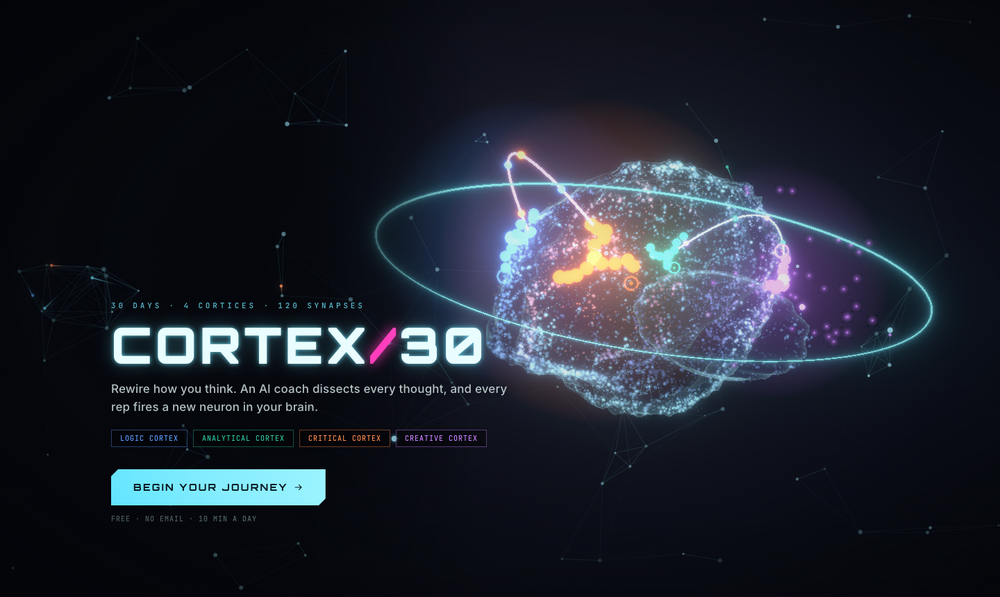
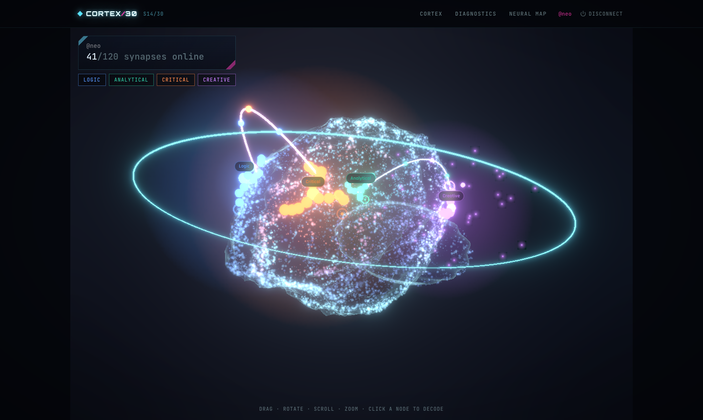
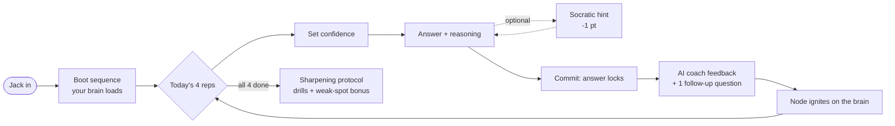
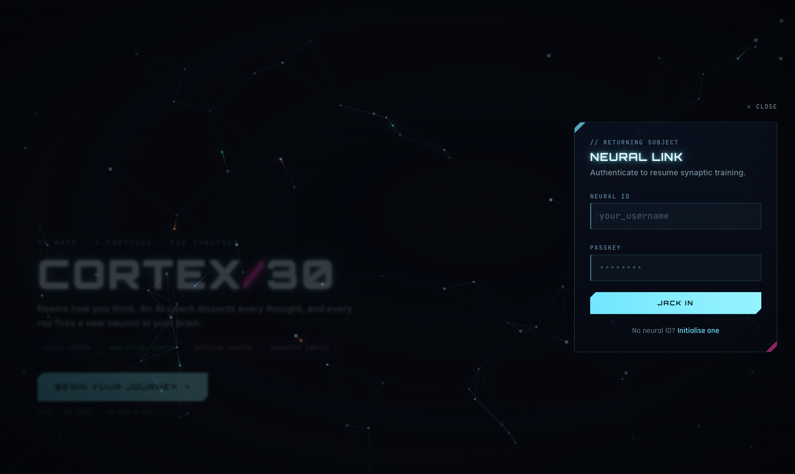
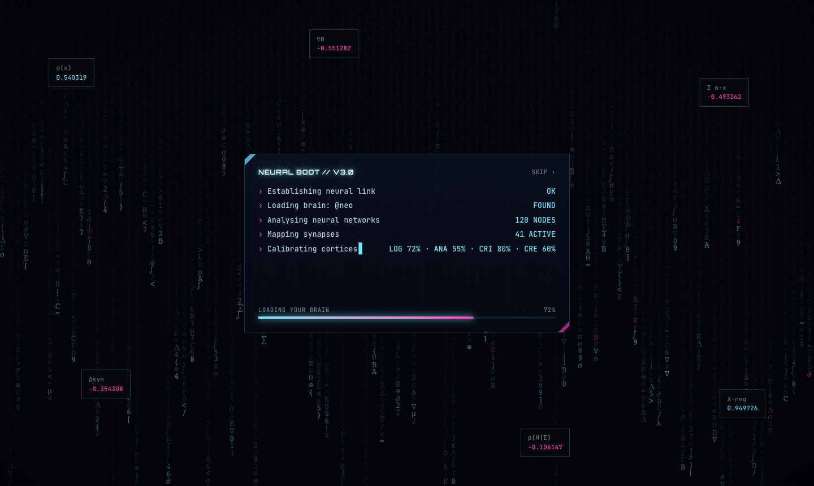
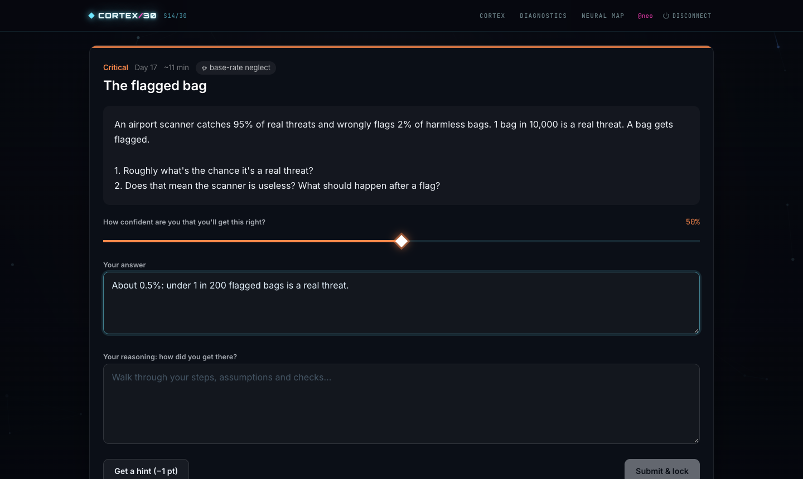
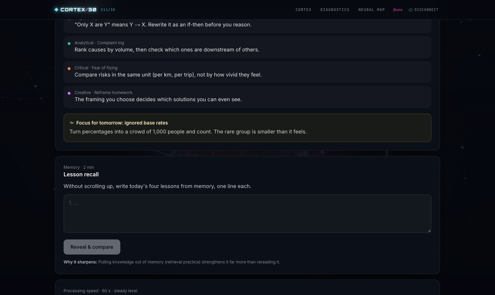
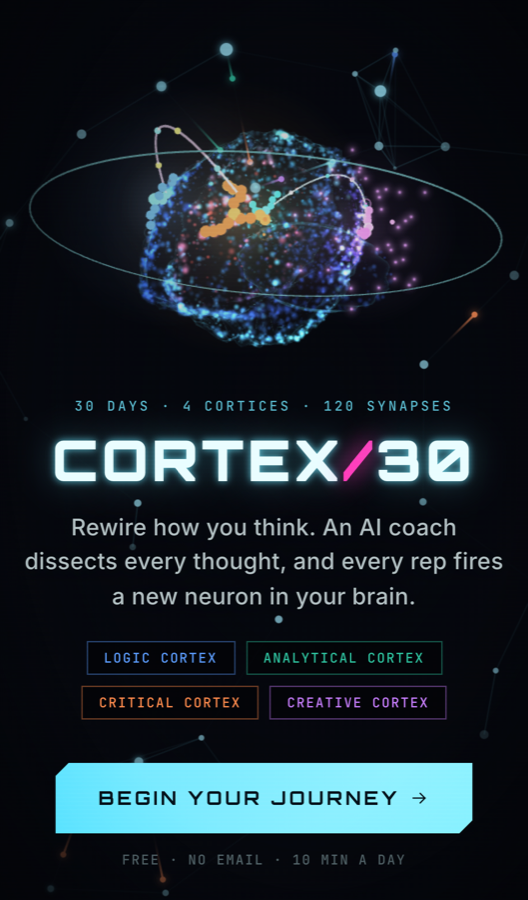
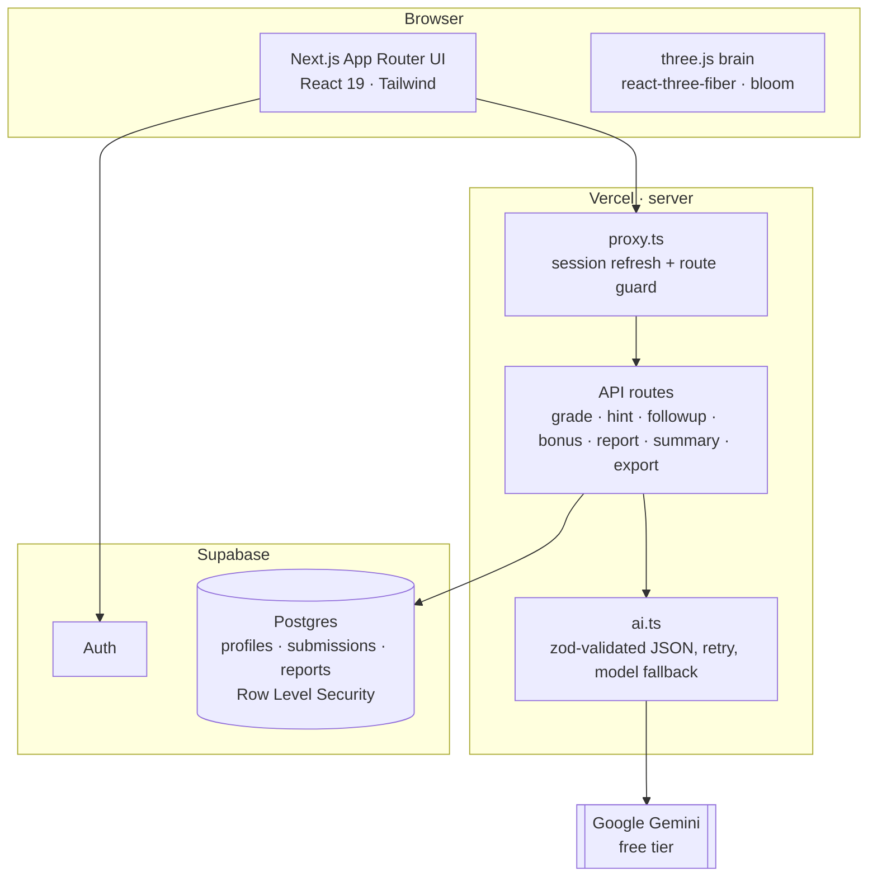

<div align="center">



# CORTEX/30

**Rewire how you think in 30 days.**
An AI coach dissects every thought. Every rep fires a new neuron in a living 3D brain.

<br />


`30 DAYS` · `4 CORTICES` · `120 SYNAPSES` · `1 AI COACH`

</div>

---

## `// 00` What is Cortex30?

Cortex30 is a **30-day training program for your thinking**. Every day unlocks four short exercises, one for each "cortex":

| Cortex | Trains | Example exercises |
| --- | --- | --- |
| **Logic** | Valid reasoning | syllogisms, knights & knaves, Wason selection, probability traps |
| **Analytical** | Structured problem-solving | Fermi estimates, driver trees, bottlenecks, value of information |
| **Critical** | Spotting flawed arguments | fallacies, biases, misleading stats, pre-mortems, decision journals |
| **Creative** | Original ideas | SCAMPER, forced connections, reverse brainstorming, constraints |

You don't just answer. You state your **confidence**, explain your **reasoning**, and an **AI coach** grades how you thought, not only what you answered: what you got right, the exact step where your logic slipped, how an expert would model the problem, and a 2-minute drill to fix it.

Your progress grows a **glowing mind map across a procedurally generated 3D brain**. Weak skills look visibly dimmer, and achievements fire bridges of light across the hemispheres.

<div align="center">

<sub>The neural map: every exercise is a node on your brain. Drag to rotate, scroll to zoom, click a node to decode your answer and the coach's feedback.</sub>
</div>

---

## `// 01` The session loop



<table>
  <tr>
    <td width="50%"></td>
    <td width="50%"></td>
  </tr>
  <tr>
    <td><sub><b>Jack in.</b> The hero brain dives toward you in a big-bang flash as you log in.</sub></td>
    <td><sub><b>Neural boot.</b> Data rain, live calculations and a typed log load your brain before it bursts into view.</sub></td>
  </tr>
  <tr>
    <td width="50%"></td>
    <td width="50%"></td>
  </tr>
  <tr>
    <td><sub><b>Focus mode.</b> The neon steps back while you read and answer: a calm, high-contrast panel.</sub></td>
    <td><sub><b>Sharpening protocol.</b> After the daily four: lesson recall, a mental-math sprint, a guided drill and an AI weak-spot drill.</sub></td>
  </tr>
</table>

---

## `// 02` Features

**The coach**
- Grades **reasoning, not just answers**: a right answer with broken logic scores as *partially correct*.
- Tags your **thinking pattern** on each answer (anchoring, confirmation bias, ignored base rates…), remembers your top three, and calls them out when they reappear.
- Socratic **hints** that only ever ask a guiding question, plus **one follow-up question** per exercise.
- **Weekly coach reports**, a daily "where you stand" summary, and a **final 30-day review** that compares your day-30 answers with day 1.

**The brain**
- Built procedurally in three.js: ~9,000 particles shaped into **real anatomy** (touching hemispheres, temporal lobes, lateral fissure, winding gyri, cerebellum, brainstem). No model files.
- 4 regions × 30 nodes growing outward like skill trees; brightness tracks score, wrong answers glow amber.
- Achievements unlock visuals: **Perfect Day** bridges, a **7-day streak** halo, sparks over the Critical and Creative regions (*Bias Hunter*, *Idea Machine*), a full-brain light-up at day 30.
- A **draggable neural network** flows behind every page: grab a neuron and it springs back.

**Diagnostics**
- Mastery levels (Beginner → Developing → Sharp → Master), skill radar, score trend.
- **Calibration matrix**: are you overconfident or underconfident, per skill?
- **Cognitive fingerprint**: your recurring thinking patterns, and which ones you've fixed.
- One-click **Markdown export** of every answer and all feedback.

**The platform**
- Username + password only. **No email, no tracking.**
- **Every user gets their own question order**: exercises are shuffled per user within each week, so difficulty still ramps up. Day 29 still reviews your day-16 decision journal, and day 30 revisits *your* day 1.
- Days unlock at local midnight (Asia/Kolkata); missed days stay open but don't count towards streaks.
- **Mobile-first**: bottom tab bar, safe-area aware, installable as a PWA.
- Respects *reduce motion*, falls back to a static SVG brain without WebGL, and drops to 3k particles with no bloom on low-end devices.

<div align="center">

</div>

---

## `// 03` Architecture



- **All AI calls run on the server.** Keys never reach the browser.
- **Row Level Security** on every table: users can only read and insert their own rows. Answers can never be edited.
- **Daily AI allowance** (15 calls per user, enforced atomically in Postgres) keeps you inside Gemini's free quota. Failed AI calls aren't counted.
- Gemini runs on `gemini-3.5-flash`, falls back to `gemini-3.5-flash-lite` when busy, with a 35 s cap per attempt.

| Layer | Tech |
| --- | --- |
| Framework | Next.js 16 (App Router), React 19, TypeScript |
| Styling | Tailwind CSS 4, framer-motion, Orbitron / Rajdhani / Inter / JetBrains Mono |
| 3D | three.js, @react-three/fiber, @react-three/drei, @react-three/postprocessing |
| Data & auth | Supabase (Postgres + Auth, RLS) |
| AI | Google Gemini (default) or Anthropic Claude (optional), behind one module |
| Charts & validation | Recharts, zod |
| Tests | Vitest |

---

## `// 04` Run it yourself (about 20 minutes, $0)

Everything runs on free tiers. You don't need a credit card.

| Piece | Free service |
| --- | --- |
| Hosting | Vercel Hobby |
| Login + database | Supabase free tier |
| AI coach | Google Gemini free tier |

You need [Node.js](https://nodejs.org) 20.9+ (22 recommended).

### 1. Create a Supabase project
1. Go to [supabase.com](https://supabase.com) and click **New project**.
2. Pick any name, set a database password, choose the region closest to you, and keep the **Free** plan.

### 2. Create the database
1. In Supabase, open **SQL Editor**, then **New query**.
2. Paste the whole of [`supabase/migrations/0001_init.sql`](supabase/migrations/0001_init.sql) and click **Run**. You should see *"Success. No rows returned"*.

### 3. Turn off email confirmation
Cortex30 logs in with a **username and password**. Behind the scenes each username becomes a fake, never-mailed address, so Supabase must not try to confirm it.

**Authentication → Sign In / Providers → Email**: keep **Enable Email provider** on, turn **Confirm email** off, then **Save**.

### 4. Get a free Gemini key
[aistudio.google.com/apikey](https://aistudio.google.com/apikey), then **Create API key**.

### 5. Configure
```bash
cp .env.example .env.local
```
```bash
NEXT_PUBLIC_SUPABASE_URL=https://your-project.supabase.co
NEXT_PUBLIC_SUPABASE_ANON_KEY=your-anon-or-publishable-key   # NOT the service_role key
AI_PROVIDER=gemini
GEMINI_API_KEY=your-gemini-key
```
Both keys are under Supabase **Project Settings → API**.

### 6. Launch
```bash
npm install
npm run dev
```
Open [localhost:3000](http://localhost:3000), click **Begin your journey**, then **Initialise one**. Today is your Day 1.

> No Gemini key yet? Set `AI_PROVIDER=mock` to click through the whole app with placeholder feedback.

### 7. Deploy to Vercel
1. Import this repository at [vercel.com/new](https://vercel.com/new).
2. Add the same four environment variables under **Environment Variables**.
3. Click **Deploy**, then open the URL on your phone and choose **Add to Home Screen**.

---

## `// 05` Security & keys

- Real keys live **only** in `.env.local` (git-ignored) and in Vercel's encrypted **Environment Variables**. The repo contains just placeholders in `.env.example`.
- `NEXT_PUBLIC_SUPABASE_ANON_KEY` is public by design. Your data is protected by the Row Level Security rules in the SQL file. **Never** use the Supabase `service_role` / secret key in this project.
- `GEMINI_API_KEY` and `ANTHROPIC_API_KEY` are read only by server routes.
- Security headers are sent on every response (HSTS, frame denial, nosniff, referrer and permissions policies), and personal pages are excluded from search engines.
- If a key ever leaks, revoke it and create a new one, then update `.env.local` and Vercel.

---

## `// 06` Commands

| Command | What it does |
| --- | --- |
| `npm run dev` | Start locally |
| `npm run build` · `npm start` | Production build · serve it |
| `npm test` | Unit tests: midnight rollover, unlock rules, streaks, mastery, achievements |
| `npm run test:grading` | Sends 3 deliberately wrong answers to the real coach and checks they're graded wrong |
| `npm run build:exercises` | Rebuild `src/data/exercises.json` from `scripts/exercises/*.mjs` |
| `npm run lint` · `npm run typecheck` | Code checks |

<details>
<summary><b>Project layout</b></summary>

```
supabase/migrations/0001_init.sql   tables, RLS, functions (run once)
scripts/exercises/*.mjs             the 120 exercises (source) → src/data/exercises.json
src/proxy.ts                        session refresh + route protection
src/lib/day.ts                      Asia/Kolkata day + unlock logic
src/lib/progress.ts                 streaks, mastery, calibration, fingerprint, achievements, bridges
src/lib/ai.ts                       gradeAnswer, getHint, generateBonus, writeReport, writeSummary
src/lib/ai/providers.ts             Gemini (REST + fallback), Claude (SDK), mock
src/app/api/*                       server routes; every AI call happens here
src/components/brain/*              procedural 3D brain, mind map, SVG fallback
src/components/NeuralField.tsx      the draggable neural-network background
```
</details>

<details>
<summary><b>Using Claude instead of Gemini (optional, paid)</b></summary>

Set `AI_PROVIDER=claude` and `ANTHROPIC_API_KEY=...`. The default model is `claude-opus-5-5`; change it with `CLAUDE_MODEL` (e.g. `claude-haiku-5-5` costs far less). The Anthropic API is **not free**.
</details>

<details>
<summary><b>Troubleshooting</b></summary>

- **"Supabase wants email confirmation"**: turn off *Confirm email* (step 3), then log in.
- **"Email address is invalid" on sign-up**: some projects reject the `.local` domain. Change it in `src/lib/auth.ts` (`usernameToEmail`) *before* anyone signs up.
- **"You've used all 15 coach calls for today"**: wait until midnight IST, or raise `AI_DAILY_LIMIT` (stay within your Gemini quota).
- **"The free Gemini quota is busy"**: wait a moment and retry. The app already falls back to `GEMINI_FALLBACK_MODEL`.
- **No 3D brain**: WebGL is off, so a static brain is shown instead.
- **Redirected to `/setup`**: a Supabase variable is missing. Restart `npm run dev` after editing `.env.local`.
</details>

---

<div align="center">
<sub>CORTEX/30 · built by <a href="https://github.com/Ali-shaiikh">Ali Shaikh</a> · 30 days to a sharper mind</sub>
</div>
